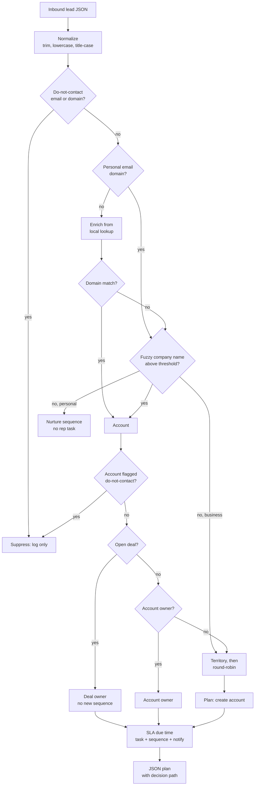

# inbound-lead-router

Takes an inbound lead, matches it to the right account, runs the guards a real sales team needs, picks an owner with an SLA, and returns the plan of actions it would take as JSON, with every decision written down.



## Quickstart

Python 3.9+ and nothing else to run it. `pytest` only for the tests.

```bash
git clone https://github.com/joshuaforwork10-sys/inbound-lead-router && cd inbound-lead-router
python3 -m router samples/leads/*.json --text           # readable decision path per lead
python3 -m router samples/leads/02_open_deal_other_owner.json   # the JSON plan
```

Run the tests with `python3 -m pytest -q`. Nothing is written unless you pass `--commit`, which only saves the round-robin pointer to `state/round_robin.json`.

## Sample output

The six sample leads each take a different path. From a real run:

```text
$ python3 -m router samples/leads/*.json --text
== 01_demo_request_existing_account.json
   normalize dana.lee@northwind-logistics.example | company 'Northwind Logistics' | source demo_request
   enrich    Northwind Logistics | US-East | 820 employees | Logistics
   match     domain northwind-logistics.example = A-100 Northwind Logistics
   assign    account owner Jordan Kim
   sla       demo_request = 15 min, due 2025-06-02T14:18:00Z
   -> routed_to_account_owner, owner Jordan Kim
   would create_task: owner=Jordan Kim, due=2025-06-02T14:18:00Z, title=Respond to demo request: Dana Lee
   would enroll_sequence: sequence=Demo follow-up, email=dana.lee@northwind-logistics.example, sender=Jordan Kim
   would notify: to=Jordan Kim, message=New demo_request from dana.lee@northwind-logistics.example, respond by 2025-06-02T14:18:00Z

== 02_open_deal_other_owner.json
   normalize it-lead@contosohealth.example | company 'Contoso Health' | source contact_sales
   enrich    Contoso Health | US-West | 2400 employees | Healthcare
   match     domain contosohealth.example = A-102 Contoso Health
   guard     open deal D-2207 (proposal) owned by Morgan Avery, not account owner Riley Chen: route to deal owner
   sla       contact_sales = 60 min, due 2025-06-02T16:20:00Z
   plan      active deal: no new sequence, the deal owner follows up by hand
   -> routed_to_deal_owner, owner Morgan Avery
   would create_task: owner=Morgan Avery, due=2025-06-02T16:20:00Z, title=Respond to contact sales: Avery Stone
   would notify: to=Morgan Avery, message=New contact_sales from it-lead@contosohealth.example, respond by 2025-06-02T16:20:00Z

== 03_personal_email_fuzzy_name.json
   normalize pat.morgan@gmail.com | company 'Fabricam Robotics Inc' | source demo_request
   guard     personal email domain gmail.com: skip domain match and enrichment
   match     name 'Fabricam Robotics Inc' ~ A-103 Fabrikam Robotics (similarity 0.94 >= 0.88)
   assign    account owner Jordan Kim
   sla       demo_request = 15 min, due 2025-06-02T17:00:00Z
   -> routed_to_account_owner, owner Jordan Kim
   would create_task: owner=Jordan Kim, due=2025-06-02T17:00:00Z, title=Respond to demo request: Pat Morgan
   would enroll_sequence: sequence=Demo follow-up, email=pat.morgan@gmail.com, sender=Jordan Kim
   would notify: to=Jordan Kim, message=New demo_request from pat.morgan@gmail.com, respond by 2025-06-02T17:00:00Z

== 04_personal_email_no_company.json
   normalize lee.w@yahoo.com | company '' | source content_download
   guard     personal email domain yahoo.com: skip domain match and enrichment
   assign    personal email with no company match: nurture, no rep task
   -> nurture, owner None
   would enroll_sequence: sequence=Newsletter nurture, email=lee.w@yahoo.com

== 05_do_not_contact_account.json
   normalize ops@tailspintravel.example | company 'Tailspin Travel' | source demo_request
   enrich    no enrichment record for tailspintravel.example
   match     domain tailspintravel.example = A-104 Tailspin Travel
   guard     account A-104 is flagged do-not-contact: suppress all outreach
   -> suppressed, owner None
   would log_only: reason=account A-104 is flagged do-not-contact

== 06_new_company_stale_id_hint.json
   normalize chris@lucernefreight.example | company 'Lucerne Freight' | source demo_request
   enrich    Lucerne Freight | US-East | 300 employees | Logistics
   match     no account with domain lucernefreight.example
   match     closest name Litware Analytics at 0.31 is under 0.88, no match
   match     ignored account id hint A-100: no domain or name evidence
   assign    territory east-central -> round-robin Jordan Kim (pool of 2)
   sla       demo_request = 15 min, due 2025-06-02T18:25:00Z
   -> new_account, owner Jordan Kim
   would create_account: domain=lucernefreight.example, name=Lucerne Freight, owner=Jordan Kim
   would create_task: owner=Jordan Kim, due=2025-06-02T18:25:00Z, title=Respond to demo request: Chris Hale
   would enroll_sequence: sequence=Demo follow-up, email=chris@lucernefreight.example, sender=Jordan Kim
   would notify: to=Jordan Kim, message=New demo_request from chris@lucernefreight.example, respond by 2025-06-02T18:25:00Z
```

Lead 02 as the JSON plan a downstream worker would execute (`python3 -m router samples/leads/02_open_deal_other_owner.json`):

```json
{
  "outcome": "routed_to_deal_owner",
  "owner": "Morgan Avery",
  "account_id": "A-102",
  "sla_due": "2025-06-02T16:20:00Z",
  "decision_path": [
    "normalize it-lead@contosohealth.example | company 'Contoso Health' | source contact_sales",
    "enrich    Contoso Health | US-West | 2400 employees | Healthcare",
    "match     domain contosohealth.example = A-102 Contoso Health",
    "guard     open deal D-2207 (proposal) owned by Morgan Avery, not account owner Riley Chen: route to deal owner",
    "sla       contact_sales = 60 min, due 2025-06-02T16:20:00Z",
    "plan      active deal: no new sequence, the deal owner follows up by hand"
  ],
  "actions": [
    {
      "type": "create_task",
      "owner": "Morgan Avery",
      "due": "2025-06-02T16:20:00Z",
      "title": "Respond to contact sales: Avery Stone"
    },
    {
      "type": "notify",
      "to": "Morgan Avery",
      "message": "New contact_sales from it-lead@contosohealth.example, respond by 2025-06-02T16:20:00Z"
    }
  ],
  "lead": {
    "email": "it-lead@contosohealth.example",
    "domain": "contosohealth.example",
    "name": "Avery Stone",
    "company": "Contoso Health",
    "source": "contact_sales",
    "received_at": "2025-06-02T15:20:00Z",
    "crm_account_id": null,
    "enrichment": {
      "company": "Contoso Health",
      "region": "US-West",
      "employees": 2400,
      "industry": "Healthcare"
    }
  }
}
```

## The guards

| Guard | What it stops | Result |
|---|---|---|
| Do-not-contact email or domain | Any outreach to someone who opted out | Checked before any lookup. Plan is `log_only`. |
| Do-not-contact account | Outreach to a company that asked to be left alone | `log_only`, no owner |
| Open deal | A second rep starting a parallel conversation on a live deal | Routes to the deal owner, even when the account owner is someone else. No new sequence. |
| Personal email domain | `gmail.com` matching every other Gmail lead, or enriching a free-mail domain | Skips domain match and enrichment, tries the company name, otherwise nurture |
| ID hint without evidence | A stale CRM id on a form merging a lead into the wrong account | The hint is logged and ignored. Only domain or name evidence makes a match. |

Matching settings, territories, SLA minutes per source and the personal-domain list live in `data/routing.json`.

## Design decisions

- **Plan, then act.** The router returns what it would do and never calls a CRM. A separate worker executes the plan. That makes every routing change testable against real leads with zero risk, and the same plan can be reviewed by a person before anything goes live.
- **Never merge on IDs alone.** A hidden form field or a copied CRM id is the easiest way to attach a lead to the wrong company. A match needs a domain or a company name above a similarity threshold. The threshold (0.88) sits high on purpose: a missed match costs a duplicate someone can merge later, a wrong match puts a prospect in another rep's deal.
- **Guards run in a fixed order.** Do-not-contact comes before everything, so an opted-out person is never even matched. The open-deal check comes before territory, so a live deal always beats the map.
- **The decision path is part of the output.** Each step adds one line. When a rep asks "why did this lead go to them?", the answer is in the plan, not in someone's memory of the workflow.
- **Round-robin state only moves on commit.** Planning the same lead twice gives the same owner, so dry runs do not quietly skew the rotation.

## Layout

```text
data/accounts.json      existing accounts, owners, open deals, DNC flags (fabricated)
data/enrichment.json    local enrichment lookup by domain
data/routing.json       threshold, guards, territories, SLAs, sequences
router/route.py         normalize, enrich, match, guards, assign, plan
router/__main__.py      CLI
samples/leads/          six leads, one per path
tests/                  one test per guard plus matching, SLA and round-robin
```

## License

MIT
